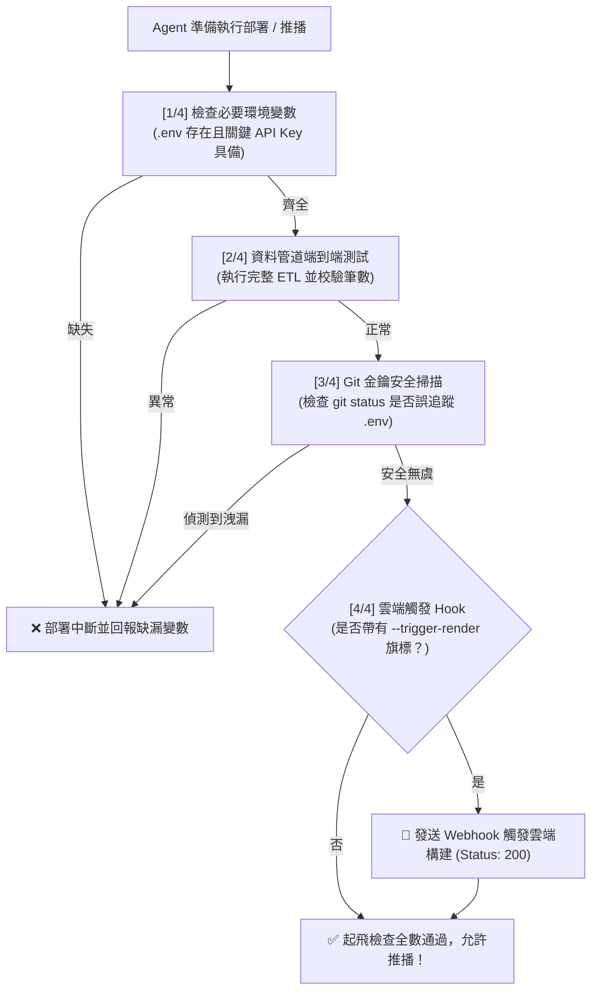

# AI Agent 自動化起飛檢查與雲端部署規範 (AI Agent Pre-flight & Deploy)

本技能建立了一套專門供 **AI Coding Agent (如 Antigravity, Claude Code, Cursor, Windsurf, Devin 等)** 在自動執行提交、推播或上線前，強制運行的**起飛前安全檢驗（Pre-flight Inspection）與部署標準**。

---

## 🎯 1. 核心理念：守護自主代理的安全交付線

當 AI Agent 具備終端機執行與 Git 推播權限時，最常見的高危險失誤包含：
1. **密鑰意外推播**：將包含真實 API Key 的 `.env` 提交進公開倉庫。
2. **破損狀態上線**：未經驗證管線完整性，將缺少資料庫或拋出語法錯誤的程式碼推至生產環境。
3. **無人值守中斷**：部署指令需要互動式確認（如未加 `--yes`），導致流程掛死。

透過在專案中規範統一的起飛檢測腳本，Agent 必須確認全綠通過（All PASS）才獲准執行雲端部署。

---

## 🚦 2. 四階段起飛檢查引擎 (4-Stage Pre-flight Engine)



---

## 📜 3. 標準可執行檢測腳本範本 (`scripts/deploy_check.py`)

此腳本設計為**零第三方外部重型依賴**（僅使用 Python 內建庫與 `dotenv`），可在任何 Python 環境毫秒級執行：

```python
"""AI Agent Pre-flight Verification & Deploy Trigger Script

Usage:
  python scripts/deploy_check.py                  # 僅執行安全性與管線檢查
  python scripts/deploy_check.py --trigger-render # 通過檢查後自動觸發雲端 Webhook
"""
import argparse
import os
import sqlite3
import subprocess
import sys
import urllib.request
from dotenv import load_dotenv

sys.stdout.reconfigure(encoding="utf-8")
load_dotenv()

def check_env() -> bool:
    print("[1/4] 檢查環境變數完整性 (Environment Variables)...")
    required_keys = ["CWA_API_KEY"]  # 依專案增減
    missing = [k for k in required_keys if not os.getenv(k)]
    if missing:
        print(f"❌ FAIL: 缺少必要環境變數: {', '.join(missing)}")
        return False
    print("✅ PASS: 必要環境變數皆已配置。")
    return True

def test_data_pipeline() -> bool:
    print("[2/4] 測試資料管線與資料庫完整性 (Pipeline Dry-run)...")
    try:
        # 測試連線與表格驗證
        db_path = "data.db"
        if not os.path.exists(db_path):
            print("⚠️ 提醒: 本地 data.db 不存在，嘗試執行初始化腳本...")
            # 視需要在此調用 python ETL 腳本
        
        if os.path.exists(db_path):
            with sqlite3.connect(db_path) as conn:
                count = conn.execute("SELECT COUNT(*) FROM TemperatureForecasts").fetchone()[0]
                print(f"✅ PASS: 資料庫校驗成功，共包含 {count} 筆有效紀錄。")
        return True
    except Exception as e:
        print(f"❌ FAIL: 管線測試拋出例外: {e}")
        return False

def check_git_secrets_leak() -> bool:
    print("[3/4] 執行 Git 機敏資訊外洩防護掃描 (Git Secrets Check)...")
    try:
        res = subprocess.run(["git", "status", "--porcelain"], capture_output=True, text=True, check=True)
        lines = res.stdout.splitlines()
        for line in lines:
            # 檢查是否有 .env 被加入暫存區或工作目錄追蹤 (排除 .env.example)
            if ".env" in line and ".env.example" not in line:
                print(f"❌ CRITICAL FAIL: 偵測到機敏檔案即將被提交至 Git: {line}")
                print("💡 請立刻在 .gitignore 內加上 .env 並執行 git reset！")
                return False
        print("✅ PASS: Git 工作目錄乾淨，無金鑰洩漏風險。")
        return True
    except Exception as e:
        print(f"⚠️ Git 狀態檢查略過: {e}")
        return True

def trigger_cloud_hook() -> bool:
    print("[4/4] 檢查雲端部署 Webhook (Cloud Deploy Hook)...")
    hook_url = os.getenv("RENDER_DEPLOY_HOOK_URL")
    if not hook_url:
        print("💡 SKIP: 未配置 RENDER_DEPLOY_HOOK_URL，略過自動 Webhook 觸發。")
        return True

    try:
        req = urllib.request.Request(hook_url, method="POST", headers={"User-Agent": "AntigravityAgent/1.0"})
        with urllib.request.urlopen(req, timeout=15) as resp:
            if resp.status in (200, 201):
                print(f"🚀 PASS: 雲端部署 Hook 觸發成功！HTTP 狀態碼: {resp.status}")
                return True
            else:
                print(f"❌ FAIL: 雲端回應非預期狀態碼: {resp.status}")
                return False
    except Exception as e:
        print(f"❌ FAIL: 觸發 Webhook 發生錯誤: {e}")
        return False

def main():
    parser = argparse.ArgumentParser(description="AI Agent Pre-flight Inspection")
    parser.add_argument("--trigger-render", action="store_true", help="自動觸發 Render Deploy Hook")
    args = parser.parse_args()

    print("=" * 60)
    print("🤖 AI Agent 起飛前置安全審查 (Pre-flight Inspection)")
    print("=" * 60)

    if not check_env(): sys.exit(1)
    if not test_data_pipeline(): sys.exit(1)
    if not check_git_secrets_leak(): sys.exit(1)

    if args.trigger_render:
        if not trigger_cloud_hook(): sys.exit(1)

    print("=" * 60)
    print("🎉 審查全數通過 (ALL CHECKS PASSED)！可安全執行推播與部署。")
    print("=" * 60)

if __name__ == "__main__":
    main()
```

---

## 🤖 4. 多 Agent 協同交接 Prompt 範本 (Sub-Agent Handoff)

當主 Agent 需要指派子 Agent 執行最後的上線部署任務時，請附上以下指令：

> **指派任務 Prompt：**
> 「請先閱讀 [DEPLOY.md](DEPLOY.md)，在終端執行 `python scripts/deploy_check.py`。
> 1. 確認四大檢查項目皆回傳 PASS。
> 2. 若通過，請以非同步方式執行 `git push origin main`。
> 3. 若有配置 `RENDER_DEPLOY_HOOK_URL`，可附帶 `--trigger-render` 參數自動觸發雲端構建。
> 4. 嚴禁在未通過安全檢查的情況下直接 force push。」
