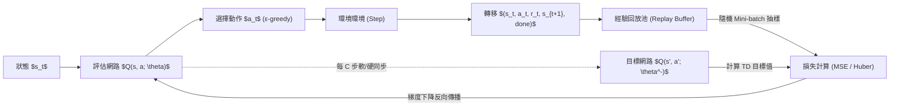

# 深度強化學習與經驗回放機制實戰指南 (Deep RL & Replay Buffers)

本技能提煉自深度強化學習課程實務（包含 Cliff Walking 導航基準測試、Gridworld 空間探索與 Deep Q-Network 模型建構），提供從**表格型強化學習（Tabular RL）**到**深度神經網路 Q 學習（DQN）**的完整架構設計規範。

---

## 🧭 1. 強化學習核心概念與數學形式化 (MDP Formulation)

任何強化學習問題皆可建模為馬可夫決策過程（Markov Decision Process, MDP）：

$$\mathcal{M} = \langle \mathcal{S}, \mathcal{A}, \mathcal{P}, \mathcal{R}, \gamma \rangle$$

- **狀態空間 $\mathcal{S}$**：環境的完整或局部特徵向量。
- **動作空間 $\mathcal{A}$**：代理人可執行的離散或連續動作。
- **獎勵函數 $\mathcal{R}(s, a, s')$**：即時回饋訊號（引導學習方向的核心）。
- **折現因子 $\gamma \in [0, 1)$**：權衡遠期回報與即時回報的權重。

---

## ⚖️ 2. 表格型演算法權衡：Q-Learning vs SARSA

在離散狀態與動作空間中，Q-Table 是最基礎的數值解法：

| 比較維度 | Q-Learning (Off-Policy 離策略) | SARSA (On-Policy 策略同層) |
| :--- | :--- | :--- |
| **更新公式** | $Q(S, A) \leftarrow Q(S, A) + \alpha [R + \gamma \max_{a} Q(S', a) - Q(S, A)]$ | $Q(S, A) \leftarrow Q(S, A) + \alpha [R + \gamma Q(S', A') - Q(S, A)]$ |
| **目標策略** | 假設下一步必定採取**理論最大值動作**（貪婪 $\max$） | 評估下一步**實際依據當前探索策略執行的動作 $A'$** |
| **行為特性** | 激進、勇敢。尋求理論最短路徑，但在帶有懸崖 (Cliff) 的探索期易掉落受罰 | 謹慎、保守。考慮探索噪音可能導致墜落，會主動遠離懸崖走安全長路 |
| **收斂目標** | 最佳動作價值函數 $Q^*(s, a)$ | 當前 $\varepsilon$-greedy 策略下的動作價值 $Q^\pi(s, a)$ |

```python
# Q-Learning 與 SARSA 核心更新實作
def update_q_learning(q_table, s, a, r, s_next, alpha=0.1, gamma=0.9):
    td_target = r + gamma * np.max(q_table[s_next])
    q_table[s, a] += alpha * (td_target - q_table[s, a])

def update_sarsa(q_table, s, a, r, s_next, a_next, alpha=0.1, gamma=0.9):
    td_target = r + gamma * q_table[s_next, a_next]
    q_table[s, a] += alpha * (td_target - q_table[s, a])
```

---

## 🧠 3. 深度 Q 網路 (Deep Q-Network, DQN) 架構

當狀態空間維度過高或連續化時，Q-Table 無法儲存，改由深度類神經網絡逼近 $Q(s, a; \theta)$。

### DQN 面臨的兩大不穩定性挑戰與解法：
1. **樣本時間自相關性 (Temporal Correlation)** $\to$ 引入**經驗回放 (Experience Replay)**，隨機打散時序樣本。
2. **目標值移動問題 (Moving Target)** $\to$ 引入獨立的**目標網路 (Target Network, $\theta^-$)**，固定週期更新。



---

## 📦 4. 雙回放機制實作 (Replay Buffers)

### 4.1 標準均勻經驗回放 (Uniform Experience Replay)

```python
import random
from collections import deque
import numpy as np

class ReplayBuffer:
    def __init__(self, capacity: int = 10000):
        self.buffer = deque(maxlen=capacity)
    
    def add(self, state, action, reward, next_state, done):
        self.buffer.append((state, action, reward, next_state, done))
        
    def sample(self, batch_size: int):
        batch = random.sample(self.buffer, batch_size)
        states, actions, rewards, next_states, dones = zip(*batch)
        return (
            np.array(states, dtype=np.float32),
            np.array(actions, dtype=np.int64),
            np.array(rewards, dtype=np.float32),
            np.array(next_states, dtype=np.float32),
            np.array(dones, dtype=np.float32)
        )
    
    def __len__(self):
        return len(self.buffer)
```

### 4.2 優先權經驗回放 (Prioritized Experience Replay, PER)

讓代理人更頻繁地學習那些**TD 誤差大（即最具意外性與資訊量）**的轉移，並透過重要性採樣權重（Importance Sampling Weights, $w_i$）消除抽樣偏差：

$$P(i) = \frac{p_i^\alpha}{\sum_k p_k^\alpha}, \quad w_i = \left( \frac{1}{N \cdot P(i)} \right)^\beta$$

```python
class PrioritizedReplayBuffer:
    def __init__(self, capacity: int = 5000, alpha: float = 0.6):
        self.capacity = capacity
        self.alpha = alpha
        self.buffer = []
        self.priorities = deque(maxlen=capacity)
        self.pos = 0

    def add(self, state, action, reward, next_state, done):
        max_prio = max(self.priorities) if self.buffer else 1.0
        if len(self.buffer) < self.capacity:
            self.buffer.append((state, action, reward, next_state, done))
            self.priorities.append(max_prio)
        else:
            self.buffer[self.pos] = (state, action, reward, next_state, done)
            self.priorities[self.pos] = max_prio
        self.pos = (self.pos + 1) % self.capacity

    def sample(self, batch_size: int, beta: float = 0.4):
        prios = np.array(self.priorities)
        probs = prios ** self.alpha
        probs /= probs.sum()

        indices = np.random.choice(len(self.buffer), batch_size, p=probs)
        samples = [self.buffer[idx] for idx in indices]

        total = len(self.buffer)
        weights = (total * probs[indices]) ** (-beta)
        weights /= weights.max()

        states, actions, rewards, next_states, dones = zip(*samples)
        return (
            np.array(states, dtype=np.float32),
            np.array(actions, dtype=np.int64),
            np.array(rewards, dtype=np.float32),
            np.array(next_states, dtype=np.float32),
            np.array(dones, dtype=np.float32),
            np.array(weights, dtype=np.float32),
            indices
        )

    def update_priorities(self, indices, errors, offset: float = 1e-5):
        for idx, error in zip(indices, errors):
            self.priorities[idx] = float(abs(error) + offset)
```

---

## 🎯 5. 探索與利用平衡 (Epsilon-Greedy Scheduling)

```python
def get_exploration_epsilon(episode: int, total_episodes: int, eps_start=1.0, eps_end=0.05, decay_rate=0.995):
    """平滑指數衰減 ε 策略"""
    return max(eps_end, eps_start * (decay_rate ** episode))
```

---

## 📋 總結：適用本技能的場景
- 需要針對機器人控制、自走車路徑規劃、遊戲 AI 或自主決策代理設計強化學習架構。
- 評估選擇 Off-policy (Q-Learning / DQN) 或 On-policy (SARSA / PPO)。
- 解決深度神經網路在強化學習中的訓練震盪、發散與經驗偏差問題。
