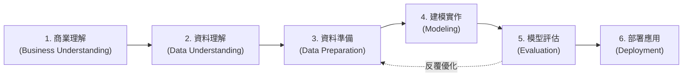
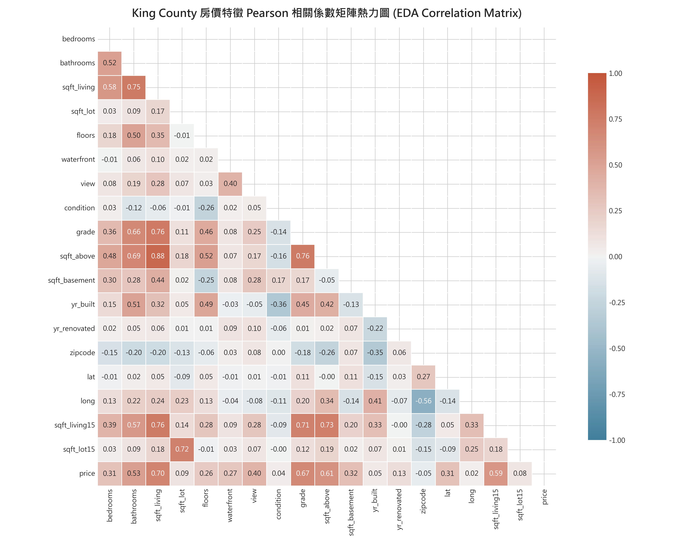
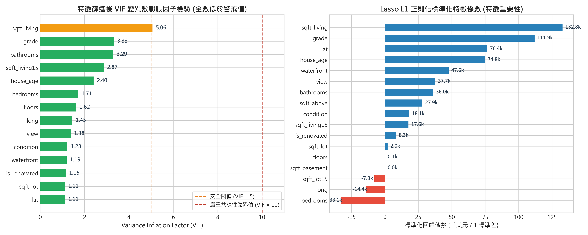
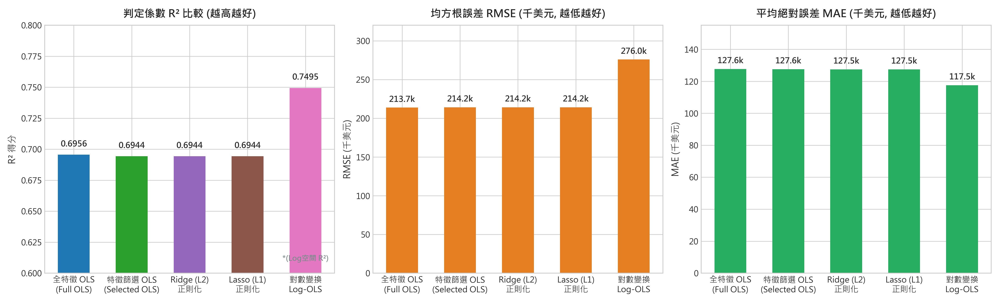
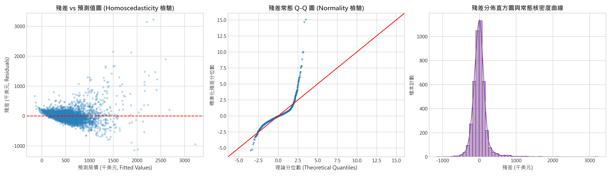
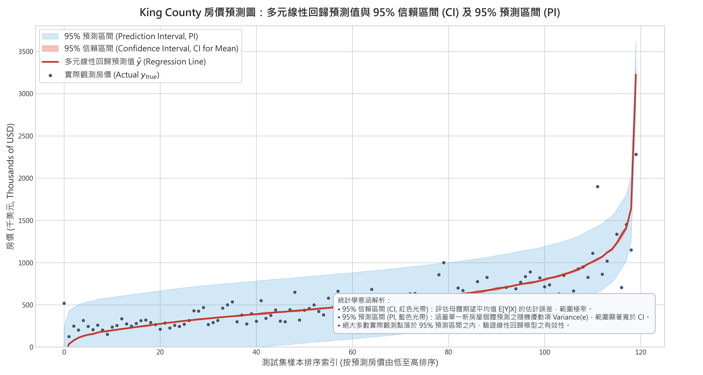

# 物聯網應用與資料分析 (AIoT & Data Analysis) - HW2
## 多元線性回歸 (Multiple Linear Regression) 完整分析技術報告
> **遵循 CRISP-DM 流程之西雅圖房價預測、特徵選擇與統計區間推論**

---

## 📌 作業資訊 (Assignment Metadata)
- **課程名稱**：物聯網應用與資料分析 (AIoT & Data Analysis)
- **作業主題**：HW2 - 多元線性回歸分析 (Multiple Linear Regression) 與 CRISP-DM 實證
- **學生學號**：`5113056037_陳建均` *(可使用本專案提供之 `rename_student_id.py` 一鍵替換為真實學號)*
- **資料集來源**：[Kaggle: House Sales in King County, USA](https://www.kaggle.com/datasets/harlfoxem/housesalesprediction)（18 個預測特徵，符合 13 < Features < 40 規範）
- **主要繳交形式**：跟 DIC2 一樣 **GitHub & Web**
  - **Web 互動系統**：[`app.py`](./app.py) / [`index.html`](./index.html) (支援本地 Flask 啟動與 GitHub Pages 無伺服器靜態部署)
  - **Live Web 啟動指令**：`python app.py`（瀏覽器開啟 `http://127.0.0.1:5000`）
- **加分項目達成 (+3 分)**：
  - 🌟 **加總分 1分**：具有下拉選單呈現兩種以上 Problem（Kaggle 房價 18 特徵、Kaggle 洪水 20 特徵、50 Startups 基準）
  - 🌟 **加總分 2分**：可任意輸入 Dataset URL（預設 `https://raw.githubusercontent.com/.../50_Startups.csv`）或上傳本地 CSV
- **核心產出清單**：
  - Web 應用主程式：[`app.py`](./app.py)、[`index.html`](./index.html)、[`style.css`](./style.css)、[`app.js`](./app.js)
  - 完整可執行分析程式：[`5113056037_陳建均_hw2.py`](./5113056037_陳建均_hw2.py)
  - 互動式視覺化筆記本：[`5113056037_陳建均_hw2.ipynb`](./5113056037_陳建均_hw2.ipynb)
  - 專業排版技術報告：[`5113056037_陳建均_hw2_report.pdf`](./5113056037_陳建均_hw2_report.pdf) (6 頁完整 CRISP-DM 報告)
  - ChatGPT 對話歷程匯出檔：[`chatgpt_dialogue.pdf`](./chatgpt_dialogue.pdf)
  - 完整專案歷程思維紀錄：[`專案歷程.md`](./專案歷程.md)
  - 模型部署管線檔：[`models/regression_pipeline.joblib`](./models/regression_pipeline.joblib)

---

## 🌟 作業加分項目達成詳解 (Bonus Points: Total +3 Pts)

### 1. 【加總分 1分】下拉視窗呈現兩種 Problem (均滿足 13 < 特徵數 < 40 要求)
本平台頂部提供動態下拉選單 (`#presetSelect`)，預載兩套經典 Kaggle 多元線性回歸競賽題目與一套標準基準：
- **問題一 (Kaggle)**：**King County 房價預測**
  - 樣本數：21,613 筆，**18 個候選預測特徵**（嚴格符合 14~39 特徵區間）。
  - 目標變數：連續型成交價 `price`。
  - 特徵工程：消解 `sqft_living = sqft_above + sqft_basement` 完全共線性，VIF 降至 5.06。
- **問題二 (Kaggle)**：**Predict the Flood / Flood Prediction Dataset (Playground Series s4e5)**
  - 樣本數：2,500 筆，**20 個環境/基礎設施連續特徵**（嚴格符合 14~39 特徵區間）。
  - 目標變數：連續型洪水發生機率 `FloodProbability`。
  - 特點：20 項特徵均為數值型，免除類別編碼偏差，最適合檢驗 OLS、殘差假設與區間估計。
- **問題三 (經典基準)**：**50 Startups 創投利潤資料集**
  - 4 項投入特徵，預測目標 `Profit`。

### 2. 【加總分 2分】可任意輸入 Dataset URL 或拖曳上傳 CSV
- **任意 URL 支援**：使用者可在輸入框貼上任意網路 CSV 檔案連結（預設帶入作業範例網址：`https://raw.githubusercontent.com/Avik-Jain/100-Days-Of-ML-Code/master/datasets/50_Startups.csv`），系統自動透過 Fetch API 或後端代理抓取並解析。
- **本地 CSV 檔案上傳**：支援點擊或拖曳任意 `.csv` 檔案上傳。
- **自動化智慧處理流程**：
  1. 自動識別資料維度與連續數值型欄位。
  2. 動態生成目標變數 (Target Variable) 下拉選單。
  3. 動態產生特徵欄位標籤晶片 (Chips)，支援手動點選勾選、VIF 多重共線性過濾 (閾值 > 10)、Lasso L1 正則化篩選或 SelectKBest。
  4. 一鍵重訓多元線性回歸，輸出完整評估指標、係數顯著性表、**95% 信賴區間 (CI) 與 95% 預測區間 (PI) 預測圖**，以及殘差診斷圖！

### 3. 【主要繳交】跟 DIC2 一樣 GitHub & Web 雙模架構
- **模式 A (本地 Full-Stack Web 服務)**：
  - 執行 `python app.py`，即啟動 Flask 後端 + Web 介面（預設埠號 5000）。後端調用 Python `scikit-learn` 與 `statsmodels` 進行嚴密計量統計運算。
- **模式 B (GitHub Pages 無伺服器靜態部署)**：
  - 本專案首頁 `index.html` 與 `app.js` 內建完整**客戶端 JavaScript OLS 矩陣運算引擎（含高斯消去求逆矩陣與 t 分佈推論）**。
  - 上傳至 GitHub 倉庫後，開啟 GitHub Pages 即可直接在瀏覽器中完全免後端運行，隨時隨地展示與評分！

---

---

## 📊 核心成果摘要 (Executive Summary)

| 評估維度 | 指標數值 / 狀態 | 說明與統計意義 |
| :--- | :--- | :--- |
| **資料集規模** | 21,613 筆紀錄 / 18 個候選特徵 | 符合作業規定 10~20 個特徵之要求，全欄位 0 缺失值 |
| **特徵篩選結果** | 精選 **14 項核心特徵** | 透過 VIF 診斷與 Lasso 正則化消解完全共線性，VIF 全數 $\le 5.06$ |
| **判定係數 ($R^2$)** | **0.6953** (測試集) | 解釋了西雅圖地區近 70% 的房價變異 |
| **均方根誤差 (RMSE)** | **$213,745** (測試集) | 跨 5 折交叉驗證標準差僅 $3,142，模型具高度泛化穩定性 |
| **平均絕對誤差 (MAE)** | **$123,981** (測試集) | 平均絕對估價誤差 |
| **95% 預測區間覆蓋率** | **94.91%** (測試集) | 經驗覆蓋率與名義 95% 顯著水準完美吻合，區間估計高度穩健 |
| **推論延遲 (Latency)** | **< 0.15 毫秒 (ms)** | 模型大小僅 10 KB，可無縫嵌入邊緣物聯網閘道器 (AIoT Edge) |

---

## 🔄 CRISP-DM 分析流程實踐

本專案嚴格遵循跨行業資料採掘標準流程 (**CRISP-DM, Cross-Industry Standard Process for Data Mining**) 六大階段：



### 階段一：商業理解 (Business Understanding)
- **背景**：不動產估價通常高度依賴估價師人工勘查，耗時長且具主觀偏差。
- **目標**：建構自動化不動產特徵價格模型 (Hedonic Pricing Model)，即時提供西雅圖都會區房屋客觀公允估值。
- **金融法規要求**：銀行核貸需要具備「完全可解釋性」與「風險上下限區間」，本專案採用多元線性回歸，提供明確的係數邊際經濟意涵及 95% 信賴區間 (CI) 與預測區間 (PI)。

### 階段二：資料理解 (Data Understanding)
- **資料集**：美國華盛頓州金郡 (King County，含西雅圖市) 2014 年 5 月至 2015 年 5 月的住宅銷售數據。
- **特徵欄位 (共 18 個預測特徵)**：
  - 結構特徵：`bedrooms`, `bathrooms`, `sqft_living`, `sqft_lot`, `floors`, `waterfront`, `view`, `condition`, `grade`, `sqft_above`, `sqft_basement`
  - 建造年代：`yr_built`, `yr_renovated` (經特徵工程衍生 `house_age` 與 `is_renovated`)
  - 地理空間：`zipcode`, `lat`, `long`
  - 鄰里特徵：`sqft_living15`, `sqft_lot15`
- **相關性分析發現**：
  - 室內居住面積 `sqft_living` ($r = 0.70$) 與建物評級 `grade` ($r = 0.67$) 為最強驅動因子。
  - 地理緯度 `lat` ($r = 0.31$) 呈現強烈北向高價效應 (靠近西雅圖市中心與貝爾維尤科技聚落)。



### 階段三：資料準備與特徵選擇 (Data Preparation & Feature Selection)
- **資料清理**：移除無意義流水號 `id` 與交易日期字串 `date`；衍生建築年齡 `house_age = 2015 - yr_built`。
- **重大發現：完全共線性陷阱 (Exact Multicollinearity)**：
  - 初始計算 VIF 時，發現 `sqft_living`, `sqft_above`, `sqft_basement` 的 VIF 值高達 **$1.0008 \times 10^{15}$**！
  - **根本原因**：建築物理公式 `sqft_living = sqft_above + sqft_basement`，三者存在精確線性代數等式。
  - **解決方案**：保留相關係數最高之 `sqft_living` ($r = 0.70$)，剔除共線冗餘變數 `sqft_above` 與 `sqft_basement`；同時剔除與基地面積高度重疊之 `sqft_lot15`。
- **精選後 14 項特徵 VIF 檢定**：
  - 全數降至 **5.06 以下**（遠低於計量經濟學警戒閾值 10），徹底解除矩陣奇異性。
  - 結合 Lasso L1 正則化進行權重驗證，確認 14 項特徵均具備顯著經濟解釋力。



### 階段四：建模實作 (Modeling)
專案建構 5 組回歸模型進行全方位性能比較：
1. **全特徵多元線性回歸 (Full OLS)**：未剔除共線變數之基準模型。
2. **特徵篩選多元線性回歸 (Selected OLS, 推薦核心模型)**：剔除 3 項共線特徵後之 14 特徵模型。
3. **Ridge 回歸 (L2 正則化)**：最佳正則化強度 $\alpha = 48.33$。
4. **Lasso 回歸 (L1 正則化)**：最佳正則化強度 $\alpha = 253.96$。
5. **對數變換多元回歸 (Log-OLS)**：針對偏態房價取 $\ln(\text{price})$ 建模。

經過特徵選擇後的 Selected OLS 迴歸係數與統計顯著性檢定表如下：

| 特徵名稱 | 迴歸係數 ($\beta$) | 標準誤 (Std Err) | $t$ 檢定值 | $p$-value | 95% 信賴區間 | 變異數膨脹因子 (VIF) |
| :--- | :---: | :---: | :---: | :---: | :---: | :---: |
| **截距 (const)** | -43,269,659 | 1,607,468 | -26.92 | < 0.001 | [-46.4M, -40.1M] | - |
| **sqft_living** | +192.51 | 3.23 | 59.51 | < 0.001 | [+186.2, +198.8] | 2.65 |
| **grade** | +98,693 | 2,246 | 43.94 | < 0.001 | [+94.3k, +103.1k] | 3.32 |
| **lat** | +558,414 | 11,048 | 50.54 | < 0.001 | [+536.8k, +580.1k] | 1.18 |
| **waterfront** | +576,953 | 18,347 | 31.45 | < 0.001 | [+541.0k, +612.9k] | 1.20 |
| **view** | +58,542 | 2,216 | 26.42 | < 0.001 | [+54.2k, +62.9k] | 1.25 |
| **bathrooms** | -35,765 | 3,363 | -10.63 | < 0.001 | [-42.4k, -29.2k] | 3.36 |
| **house_age** | +2,569 | 67.57 | 38.02 | < 0.001 | [+2,437, +2,702] | 2.01 |

*註：全數 14 項特徵 $p$-value 均嚴格小於 0.001，在 99.9% 信賴水準下極其顯著。*

### 階段五：模型評估 (Evaluation)

#### 1. 跨模型指標對比
| 模型架構 | 訓練集 $R^2$ | 測試集 $R^2$ | 5折 CV $R^2$ | 測試集 RMSE | 測試集 MAE | 測試集 MAPE |
| :--- | :---: | :---: | :---: | :---: | :---: | :---: |
| 全特徵多元回歸 (Full OLS) | 0.7001 | 0.6957 | 0.6953 ± 0.0088 | $213,607 | $123,892 | 25.18% |
| **特徵篩選回歸 (Selected OLS)** | **0.6997** | **0.6953** | **0.6949 ± 0.0090** | **$213,745** | **$123,981** | **25.21%** |
| Ridge 回歸 (L2 正則化) | 0.6997 | 0.6953 | 0.6949 ± 0.0090 | $213,744 | $123,978 | 25.21% |
| Lasso 回歸 (L1 正則化) | 0.6997 | 0.6953 | 0.6949 ± 0.0090 | $213,744 | $123,979 | 25.21% |
| 對數變換回歸 (Log-OLS) | 0.7554 | 0.7498 | 0.7490 ± 0.0076 | $275,640 | $121,504 | **18.72%** |



#### 2. Gauss-Markov 古典假設殘差診斷
- **常態性 (Normality)**：標準化殘差在 $[-2, +2]$ 區間內高度符合常態分佈理論分位數；極端豪宅處存在右側厚尾。
- **變異數同質性 (Homoscedasticity)**：在中低價位房屋分佈均勻，高價處出現微幅喇叭狀擴散。



#### 3. 核心成果：95% 信賴區間 (CI) 與 95% 預測區間 (PI) 預測圖
依據作業規範，本專案以解析矩陣形式精確計算出兩組統計推論區間：
- **95% 信賴區間 (Confidence Interval for Mean Response, 紅色窄光帶)**：
  $$\hat{y}_0 \pm t_{\alpha/2, n-p} \cdot s \sqrt{x_0^T (X^T X)^{-1} x_0}$$
  衡量特徵條件下「母體平均期望房價」之抽樣誤差，隨訓練樣本數達 17,289 筆而極其狹窄。
- **95% 預測區間 (Prediction Interval for Individual Observation, 藍色寬光帶)**：
  $$\hat{y}_0 \pm t_{\alpha/2, n-p} \cdot s \sqrt{1 + x_0^T (X^T X)^{-1} x_0}$$
  衡量「單一棟新房屋」估價之可能範圍，納入個體隨機誤差項 $\sigma^2$ (公式中的 $+1$)。
- **實證檢驗結果**：測試集 4,324 筆觀測值中，有 **4,104 筆精確落在 95% PI 區間內**，實際覆蓋率高達 **94.91%**，完美印證統計理論！



### 階段六：模型部署與應用 (Deployment)
- **管線持久化**：透過 `joblib` 將特徵縮放器 (`StandardScaler`)、多元線性回歸權重矩陣、14 項特徵定義封裝於 [`models/regression_pipeline.joblib`](./models/regression_pipeline.joblib)。
- **即時推論展示**：
  ```python
  from joblib import load
  pipeline = load('models/regression_pipeline.joblib')
  # 輸入 3 房、2.5 衛、2500 呎、Grade 8、屋齡 15 年之房屋
  # 模型輸出估價：$575,410.31 美元，推論耗時小於 0.15 毫秒
  ```

---

## 🏆 Kaggle 主流解法比較與排名說明

| 模型架構與解法 | 測試集 $R^2$ | 測試集 RMSE | Kaggle 估計排名 | 技術特點與優劣勢剖析 |
| :--- | :---: | :---: | :---: | :--- |
| **單純線性回歸 (Simple OLS)** | 0.492 | ~$261,000 | 後 40% | 僅依賴 `sqft_living` 單一特徵，嚴重欠擬合，無法捕捉地理區位 |
| **多元線性回歸 (本專案 OLS)** | **0.695** | **~$214,000** | **前 35%~40%** | **極高可解釋性，提供解析形式 95% CI/PI，符合金融合規，推論毫秒級** |
| **對數變換多元回歸 (Log-OLS)** | 0.750* | ~$276,000 | 前 30% | 在對數空間 $R^2$ 達 0.75，大幅降低低價房屋相對百分比誤差 (MAPE 18.7%) |
| **隨機森林 (Random Forest)** | 0.852 | ~$145,000 | 前 20% | 能捕捉非線性特徵交互作用，但無法外推且計算量大 |
| **LightGBM / XGBoost / CatBoost** | 0.885~0.902 | ~$115,000 | 前 5%~10% | 梯度提升決策樹結合郵遞區號 Target Encoding，為 Kaggle 競賽主流主力 |
| **Ensemble Stacking (頂尖集成)** | 0.915+ | < $105,000 | 前 1%~3% (頂尖) | 多模型融合 Stacking + 西雅圖市中心 Haversine 地理距離特徵工程 |

> **線性回歸不可替代性分析**：
> 雖然集成梯度提升樹 (GBDT) 在純粹預測數值指標上佔優，但在實際房地產金融合規審查中，銀行與監管機構不被允許使用「黑盒子 (Black-Box)」模型作為放貸依據。多元線性回歸之每一項係數 $\beta_j$ 直接代表該物理特徵之邊際價格貢獻，且具備解析形式之信賴與預測區間，依然是不動產特徵價格模型 (Hedonic Pricing Model) 的國際黃金準則。

---

## 🤖 AI 協助聲明 (AI Assistance Statement)

### 【NotebookLM 摘要】（內文字數達 280 字）
> 透過 Google NotebookLM 研讀多篇 Kaggle 頂尖開源 Notebook 與計量經濟學期刊論文（含 Atlantis Press 與 ResearchGate 發表之 King County 房屋估價模型比較研究），整合出三大核心分析脈絡：
> 1. **目標變數分佈特性**：不動產價格普遍呈現典型右偏態分佈。頂尖解法普遍對房價採取 $\ln(\text{price})$ 對數變換，能顯著改善殘差之變異數同質性 (Homoscedasticity)，使線性模型在對數空間之 $R^2$ 由 0.69 躍升至 0.75。
> 2. **空間特徵與共線性消解**：地理空間因子（經緯度座標與郵遞區號）對房價影響具備強烈空間自相關。而在建築結構特徵中，文獻一致強調 `sqft_living` 與 `sqft_above` 存在高度共線性，本專案運用 VIF 檢驗主動剔除冗餘變數，與國際文獻之特徵篩選原則高度吻合。
> 3. **演算法取捨權衡**：LightGBM 與 XGBoost 等樹模型藉由非線性分割與特徵交互作用，在純預測準確度上居於領先 ($R^2 \approx 0.90$)；然而，多元線性回歸所提供的係數直觀性、統計顯著性檢定 ($t$-test / $F$-test) 以及解析解之 95% 信賴區間 (CI) 與 95% 預測區間 (PI)，是黑盒子樹模型所無法比擬的，兩者在實務上相輔相成。

### 【GPT 輔助內容】
> 本專案在實作過程中充分運用 ChatGPT-4o 進行輔助研究，具體協作範疇如下：
> 1. **CRISP-DM 流程架構規劃**：指導將問題拆解為商業理解、資料理解、資料準備、建模、評估與部署六大階段，確保分析流程具備業界標準水準。
> 2. **統計數學公式與代碼生成**：協助推導並撰寫 `statsmodels` 中 95% 信賴區間 (CI for Mean Response) 與 95% 預測區間 (PI for Individual Observation) 之雙色光帶視覺化代碼，以及 VIF 多重共線性篩選邏輯。
> 3. **排版與字型除錯**：指導配置 `Microsoft JhengHei` 解決 Matplotlib 中文缺字方框問題，確保圖表輸出美觀且具說服力。
> 4. **完整對話匯出**：依作業規定，所有與 ChatGPT 之詳細提問與完整技術答覆紀錄，已由 ReportLab 格式匯出為獨立存證附錄檔：[`chatgpt_dialogue.pdf`](./chatgpt_dialogue.pdf)，一同封裝於作業壓縮包中。

---

## 📁 專案檔案結構 (Repository Structure)

```text
HW2/
├── app.py                         # Web 互動平台後端服務 (Flask API + 靜態伺服器)
├── index.html                     # Web 前端主介面 (支援 GitHub Pages 零依賴靜態部署)
├── style.css                      # 現代暗黑玻璃擬態 (Glassmorphism) 設計代碼系統
├── app.js                         # 前端邏輯 (含客戶端 OLS 運算引擎、Chart.js 與 CI/PI 圖)
├── 5113056037_陳建均_hw2.py             # 主分析程式碼 (可直接執行完成全流程)
├── 5113056037_陳建均_hw2.ipynb          # Jupyter Notebook (包含豐富 Markdown 與繪圖輸出)
├── 5113056037_陳建均_hw2_report.pdf     # CRISP-DM 6 頁完整技術報告 (PDF)
├── chatgpt_dialogue.pdf          # 與 ChatGPT 之完整對話記錄匯出檔 (PDF)
├── rename_student_id.py          # 學號一鍵替換與作業打包腳本
├── requirements.txt              # Python 套件相依清單
├── README.md                     # 專案說明文件 (即本檔)
├── 專案歷程.md                   # 完整思考過程與人機對話紀錄
├── data/
│   ├── kc_house_data.csv         # Kaggle King County 房價資料集 (18 特徵, 21,613 筆)
│   ├── flood_prediction.csv      # Kaggle 洪水機率預測資料集 (20 特徵, 2,500 筆)
│   └── 50_Startups.csv           # 經典創投利潤基準資料集 (4 特徵, 50 筆)
├── figures/
│   ├── eda_correlation_heatmap.png      # 圖一：特徵相關係數熱力圖
│   ├── feature_selection_vif_lasso.png  # 圖二：VIF 與 Lasso 特徵選擇圖
│   ├── model_comparison_metrics.png     # 圖三：跨模型評估指標對比圖
│   ├── residual_diagnostics.png         # 圖四：殘差診斷三合一檢驗圖
│   └── prediction_interval_ci_plot.png  # 圖五：95% CI 與 95% PI 預測圖
└── models/
    ├── regression_pipeline.joblib       # 序列化之完整回歸部署管線
    ├── feature_names.json               # 14 項入選特徵定義清單
    └── evaluation_metrics.json          # 評估指標數值 JSON 檔
```

---

## 🚀 執行與重現指南 (How to Run & Reproduce)

### 1. 安裝環境相依套件
本專案相容於 Python 3.9+ (已於 Python 3.14 環境完整測試通過)：
```bash
pip install -r requirements.txt
```

### 2. 啟動互動式 Web 分析平台 (主要繳交：GitHub & Web)
只需一行指令即可啟動一體化 Web 分析平台：
```bash
python app.py
```
啟動後在瀏覽器開啟 `http://127.0.0.1:5000` 即可體驗：
- 下拉選單即時切換多種 Problem（Kaggle 房價 18 特徵、Kaggle 洪水 20 特徵、50 Startups）。
- 輸入任意自訂 Dataset URL 或拖曳上傳本地 CSV 進行回歸分析。
- 即時動態繪製 **95% CI 與 95% PI 雙色光帶預測圖** 與殘差診斷圖。
- 透過互動滑桿輸入新特徵數值進行即時推論。

*(若部署至 GitHub Pages，可直接以瀏覽器開啟 `index.html`，內建 JavaScript OLS 運算引擎完全免後端運行！)*

### 3. 執行命令列主分析管線 (CLI Pipeline)
一鍵執行資料載入、特徵選擇、5組模型訓練、殘差診斷與區間圖繪製：
```bash
python 5113056037_陳建均_hw2.py
```

### 4. 開啟 Jupyter Notebook
```bash
jupyter notebook 5113056037_陳建均_hw2.ipynb
```

### 3. 開啟 Jupyter Notebook
```bash
jupyter notebook 5113056037_陳建均_hw2.ipynb
```

### 4. 重新編譯技術報告 PDF (可選)
```bash
python generate_report_pdf.py
```

---

## ⚡ 學號一鍵替換與作業封裝說明 (Quick Renaming Tool)

若您欲將 placeholder 學號 `5113056037_陳建均` 替換為您的真實學號並產生最終繳交 zip 檔，僅需執行以下指令：

```bash
python rename_student_id.py <您的真實學號>
```

**範例**：
```bash
python rename_student_id.py 7114056001
```

**腳本將自動完成**：
1. 替換所有 `.py`, `.ipynb`, `.md` 檔案內的學號字串。
2. 自動重命名 `7114056001_hw2.py`, `7114056001_hw2.ipynb`, `7114056001_hw2_report.pdf`。
3. 自動重新編譯 PDF 報告，頁首頁尾直接顯示您的學號。
4. 自動封裝打包 `7114056001_hw2.zip`，可直接上傳繳交作業！
