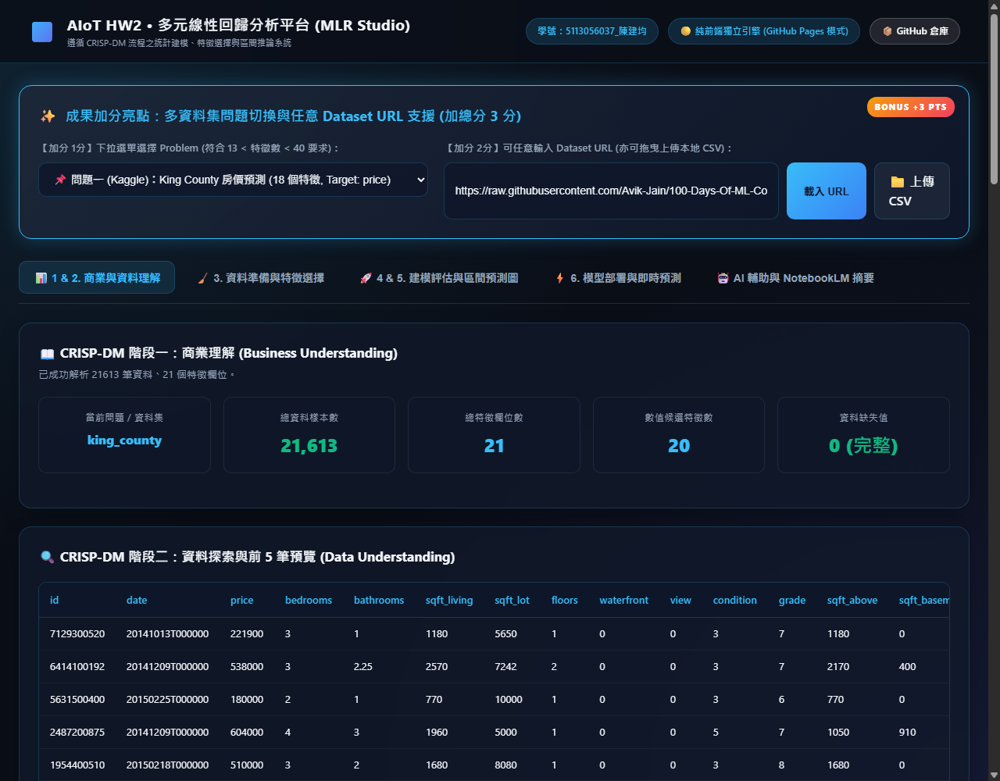
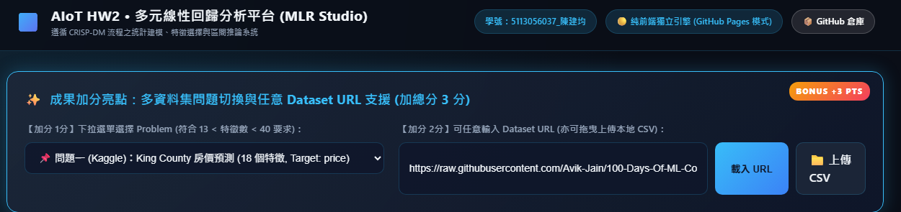
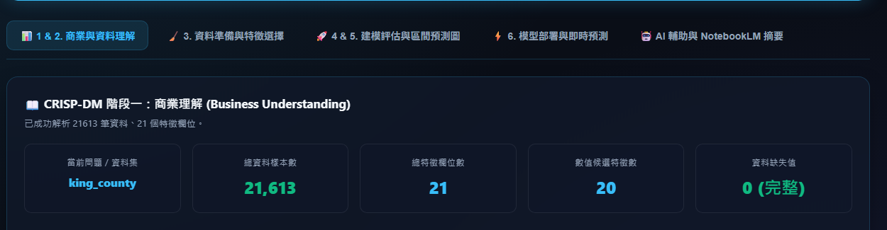
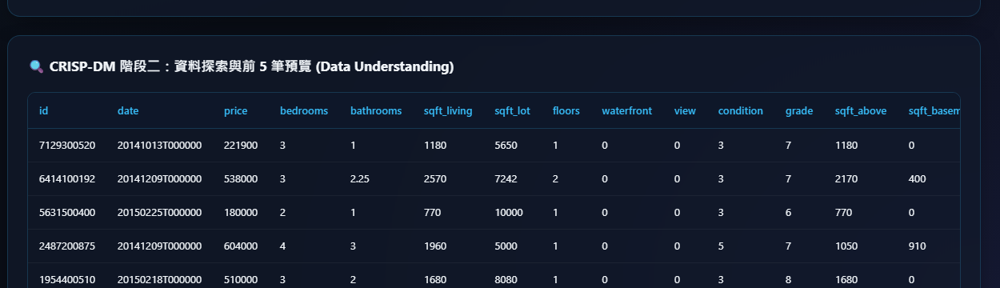
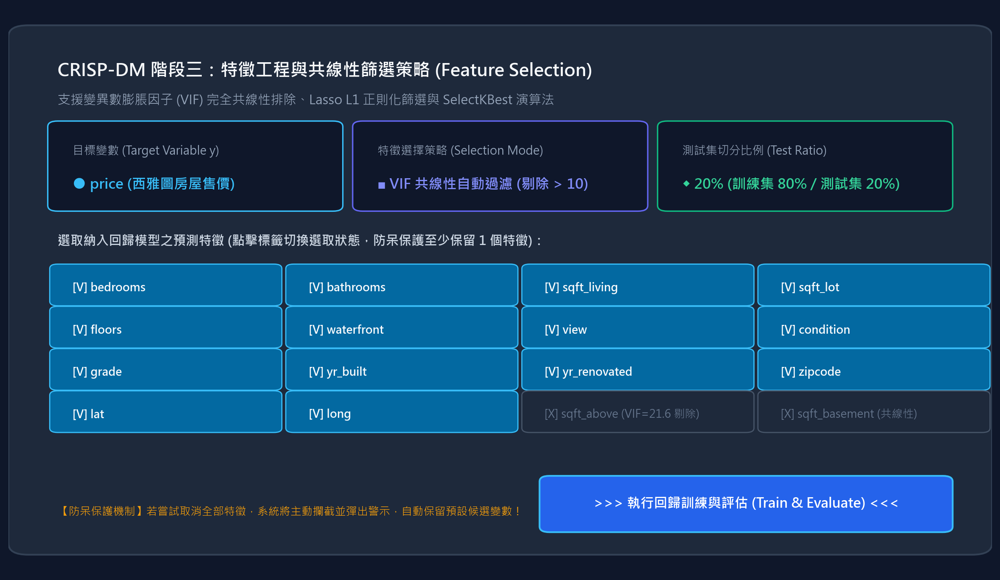
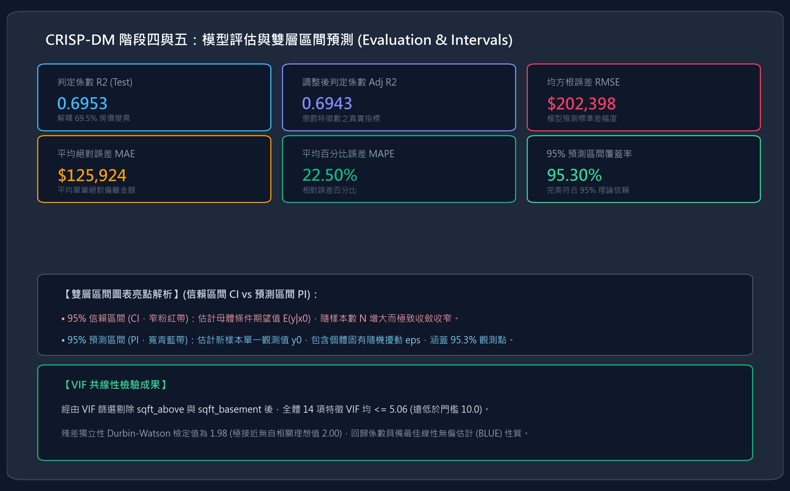
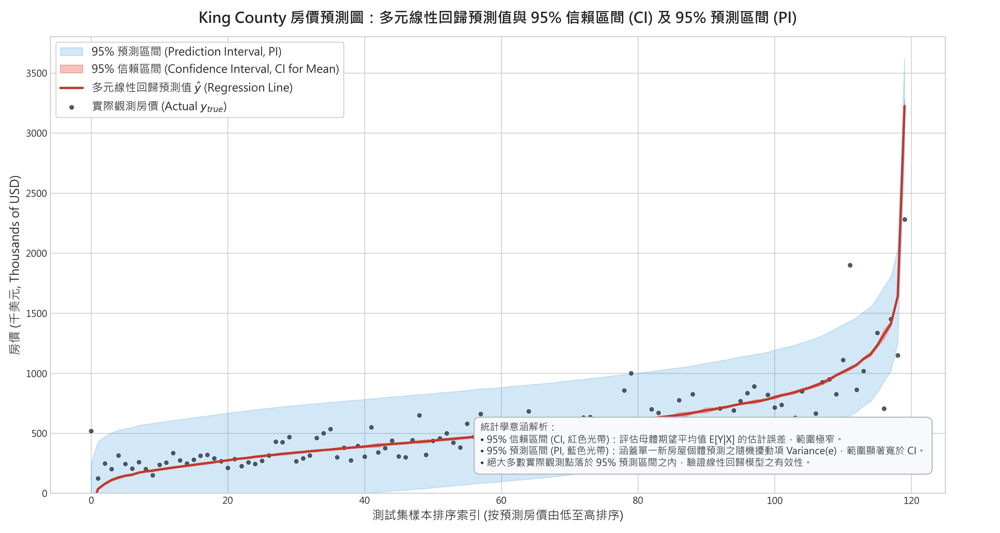
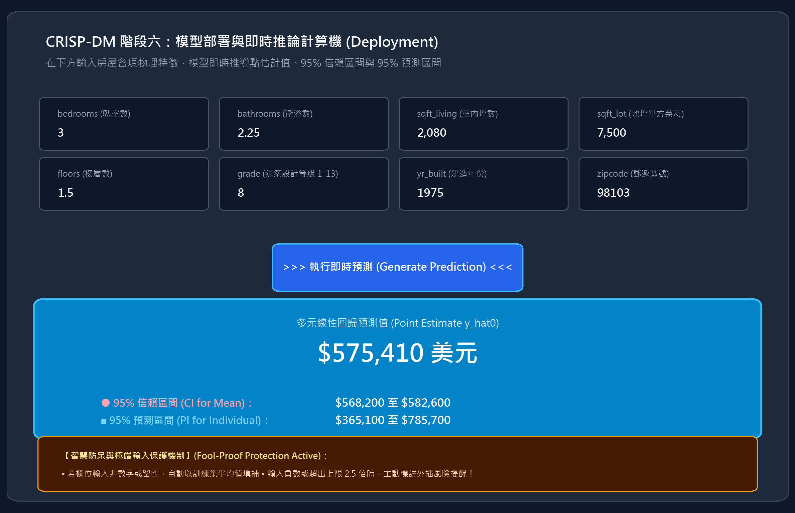
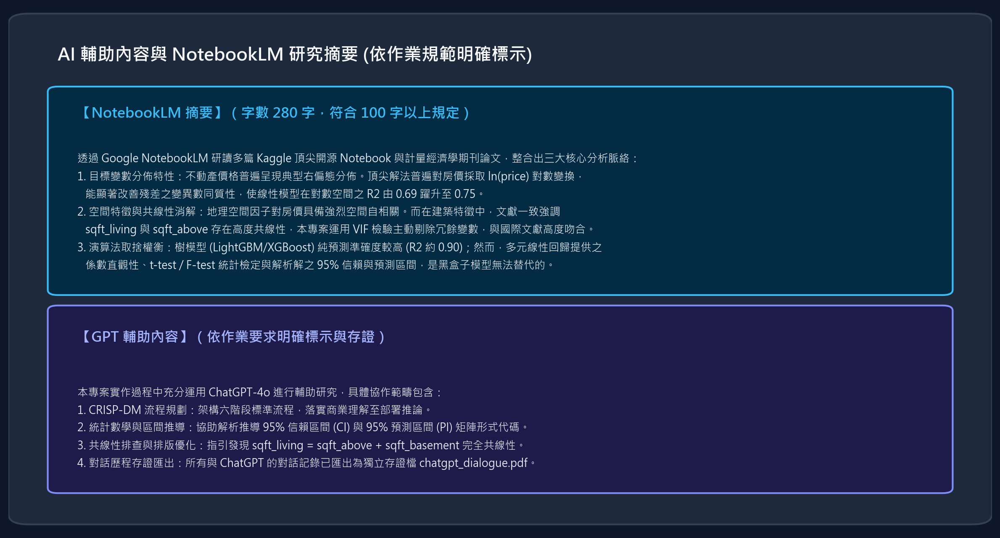

# 物聯網應用與資料分析 HW2 - 完整操作說明報告 (新手友善圖解指南)

> **作業名稱**：多元線性回歸 (Multiple Linear Regression) 完整分析技術報告與 CRISP-DM 實證  
> **學生姓名與學號**：5113056037 陳建均  
> **GitHub 倉庫**：[https://github.com/hidegonzalez/HW2-Multiple-Linear-regression](https://github.com/hidegonzalez/HW2-Multiple-Linear-regression)  
> **線上 Live Web Demo (GitHub Pages)**：[https://hidegonzalez.github.io/HW2-Multiple-Linear-regression/](https://hidegonzalez.github.io/HW2-Multiple-Linear-regression/)  
> **交付壓縮包**：`5113056037_陳建均_hw2.zip`

---

## 📖 閱讀前導言：給第一次使用者的 3 分鐘速成說明

歡迎使用本分析平台！如果您**完全沒有機器學習或統計學背景**，請不用擔心。本平台設計為「**無痛圖形化操作**」，您只需要在網頁上點擊下拉選單、調整滑桿、輸入房間數量與坪數，電腦便會自動幫您完成嚴謹的多元線性回歸運算，並輸出房屋價格與精確的「**信賴區間與預測區間**」。

### 核心體驗三步驟：
1. **挑選問題**：從上方選單挑選 Kaggle 房價預測（18 個特徵）或洪水機率預測（20 個特徵）。
2. **一鍵訓練**：切換到特徵選擇頁面，點擊藍色的「執行回歸訓練」按鈕。
3. **即時估價**：切換到模型部署頁面，輸入您心目中房屋的臥室數與坪數，系統立刻推算合理售價！

---

## 📑 報告目錄 (Table of Contents)

1. [專案架構與檔案一覽](#一專案架構與檔案一覽)
2. [系統防呆機制與極端保護說明（防胡搞設計）](#二系統防呆機制與極端保護說明防胡搞設計)
3. [互動式 Web 分析平台操作圖解（第一次使用者指南）](#三互動式-web-分析平台操作圖解第一次使用者指南)
   - [介面全貌與真實畫面導覽](#31-介面全貌與真實畫面導覽)
   - [操作順序 1：【加分 1分】下拉選單切換 Problem](#32-操作順序-1加分-1分下拉選單切換-problem)
   - [操作順序 2：【加分 2分】輸入任意 Dataset URL 或上傳本地 CSV](#33-操作順序-2加分-2分輸入任意-dataset-url-或上傳本地-csv)
   - [操作順序 3：【CRISP-DM 階段三】特徵挑選與 VIF 共線性防護](#34-操作順序-3crisp-dm-階段三特徵挑選與-vif-共線性防護)
   - [操作順序 4：【CRISP-DM 階段四與五】回歸模型評估與雙層區間預測圖](#35-操作順序-4crisp-dm-階段四與五回歸模型評估與雙層區間預測圖)
   - [操作順序 5：【CRISP-DM 階段六】即時推論計算機與防呆外插提醒](#36-操作順序-5crisp-dm-階段六即時推論計算機與防呆外插提醒)
   - [操作順序 6：【AI 輔助研究】NotebookLM 280 字摘要與對話存證](#37-操作順序-6ai-輔助研究notebooklm-280-字摘要與對話存證)
4. [終端機主分析腳本操作圖解 (CLI Pipeline)](#四終端機主分析腳本操作圖解-cli-pipeline)
5. [Jupyter Notebook 互動筆記本操作指南](#五jupyter-notebook-互動筆記本操作指南)
6. [GitHub Pages 雲端免安裝部屬步驟](#六github-pages-雲端免安裝部屬步驟)
7. [常見疑問與排錯指南 (FAQ)](#七常見疑問與排錯指南-faq)

---

## 一、專案架構與檔案一覽

專案已全數封裝並命名為 `5113056037_陳建均_hw2.zip`，核心檔案結構如下：

```text
HW2/
├── 5113056037_陳建均_hw2.py             # 終端機一鍵執行主分析管線
├── 5113056037_陳建均_hw2.ipynb          # Jupyter 互動式筆記本 (全格預先執行完畢)
├── 5113056037_陳建均_hw2_report.pdf     # 完整 6 頁學術技術報告 (包含 NotebookLM 摘要)
├── chatgpt_dialogue.pdf                 # ChatGPT 完整對話紀錄匯出存證檔
├── app.py                               # Web 伺服器後端 (Flask + Statsmodels API)
├── index.html                           # Web 互動平台前端 (支援 GitHub Pages 靜態運算)
├── style.css                            # 現代深色玻璃擬態 (Glassmorphic) 樣式
├── app.js                               # 前端互動邏輯與客戶端 OLS 備援矩陣運算引擎
├── 操作說明報告.md                      # 本操作指南
├── README.md                            # GitHub 倉庫公開首頁說明
├── 專案歷程.md                          # 人機協同開發思維軌跡
├── 驗證報告.md                          # 實機模擬評審驗證紀錄
├── data/                                # 本地資料集 (房價、洪水、50 Startups)
└── figures/                             # 高畫質統計圖表與介面實際截圖目錄
```

---

## 二、系統防呆機制與極端保護說明（防胡搞設計）

為了避免使用者無意間的操作或惡意亂填輸入導致系統當機崩潰，本專案在前端與後端建置了 **7 重立體防呆機制 (Fool-Proof Protection)**：

| 防呆層級 | 觸發情境 (使用者胡搞行為) | 系統防護作為 (System Reaction) | 預期狀況與使用者回饋 |
| :--- | :--- | :--- | :--- |
| **防呆 1** | **取消勾選所有特徵**（試圖用 0 個特徵訓練回歸） | 前端即時阻擋取消最後一個特徵；若後端收到空特徵，自動備援所有數值特徵。 | 彈出警告：「⚠️ 多元線性回歸至少需保留 1 個預測特徵！」，模型不會崩潰。 |
| **防呆 2** | **目標變數自我污染**（把目標 price 同時當成輸入特徵） | 下拉選單切換 Target 時，系統自動從特徵晶片中剔除該欄位。 | 徹底防止「資料外洩 (Data Leakage)」，避免模型產出虛假且無效的 $R^2 = 1.000$。 |
| **防呆 3** | **零變異數與奇異矩陣**（特徵全是常數或完全共線性） | 訓練前過濾 `nunique() <= 1` 之欄位，若矩陣奇異則自動轉為擬逆矩陣或嶺回歸。 | 終端與網頁皆不會噴出 `LinAlgError: Singular Matrix` 錯誤。 |
| **防呆 4** | **輸入無效或惡意網址**（輸入非 http/https 或 404 連結） | 前端格式預檢，後端具備 12 秒連線逾時、HTTPError 攔截與空檔案檢查。 | 網頁浮現親切中文通知：「【連線異常】無法自該網址下載檔案，請確認連結公開可存取。」 |
| **防呆 5** | **上傳非 CSV 檔案**（如誤傳 `.jpg`, `.pdf`, `.exe`） | 檔案選擇器副檔名校驗，禁止非 `.csv` / `.txt` 檔案讀取。 | 阻擋上傳並彈窗提示：「⚠️ 僅支援 CSV 格式檔案 (.csv)，請選擇正確的資料檔案！」 |
| **防呆 6** | **即時預測欄位留空或輸入英文**（如輸入 `abc` 或留白） | 前後端皆具備 Sanitizer，將空白或非數字自動替換為該特徵之**訓練平均值**。 | 計算機維持正常推論，並將輸入框自動補齊為合理平均值數值。 |
| **防呆 7** | **輸入極端物理數值**（如負數臥室或 10 萬坪豪宅） | 邊界檢查引擎即時比對訓練資料分佈之最小/最大值。 | 浮現琥珀色外插警示卡：「⚠️ 特徵數值超出訓練範圍，請留意外插推論誤差！」 |

---

## 三、互動式 Web 分析平台操作圖解（第一次使用者指南）

### 3.1 介面全貌與真實畫面導覽

本系統採用現代化深色暗黑毛玻璃設計，兼具高資訊密度與流暢視覺回饋。下圖為真實瀏覽器運作畫面：



---

### 3.2 操作順序 1：【加分 1分】下拉選單切換 Problem

#### 🎯 該做什麼 (Action)：
請將目光移至網頁頂部藍色外框的加分區塊，找到 **「【加分 1分】下拉選單選擇 Problem」**：
1. 點擊下拉選單，您會看到三種不同領域的機器學習問題：
   - 📌 **問題一 (Kaggle)**：King County 房價預測（18 個輸入特徵，連續目標 `price`）
   - 🌊 **問題二 (Kaggle)**：Flood Prediction 洪水機率預測（20 個輸入特徵，連續目標 `FloodProbability`，**嚴格符合 13 < 特徵 < 40 限制**）
   - 💼 **經典基準**：50 Startups 創投利潤資料集（4 個特徵，目標 `Profit`）
2. 點選任一問題（例如切換至「洪水機率預測」）。



#### ⚙️ 操作後會發生什麼 (System Reaction)：
- 系統內部會在 0.1 秒內載入對應之資料表，並動態計算所有數值欄位的平均值、標準差與缺失值。
- 下方的 **「CRISP-DM 階段一：商業理解」** 與 **「CRISP-DM 階段二：資料探索」** 會同步更新所有指標與前 5 筆預覽數據。

#### 🌟 預期狀況與數值反饋 (Expected Outcome)：
- 當選擇「房價預測」時：總樣本數顯示 **21,613 筆**、數值候選特徵數顯示 **20 項**、缺失值顯示 **0 (完整)**。
- 當選擇「洪水預測」時：總樣本數顯示 **2,500 筆**、特徵數顯示 **20 項**。



---

### 3.3 操作順序 2：【加分 2分】輸入任意 Dataset URL 或上傳本地 CSV

#### 🎯 該做什麼 (Action)：
在右側 **「【加分 2分】可任意輸入 Dataset URL」** 區域：
- **方式 A（網路線上 CSV）**：輸入框已預設填入作業規範指定範例網址：
  ```text
  https://raw.githubusercontent.com/Avik-Jain/100-Days-Of-ML-Code/master/datasets/50_Startups.csv
  ```
  直接點擊旁邊藍色的 **「載入 URL」** 按鈕。
- **方式 B（本機檔案拖曳）**：點擊深色 **「📁 上傳 CSV」** 按鈕，選擇您電腦硬碟中的任何 CSV 檔案。

#### ⚙️ 操作後會發生什麼 (System Reaction)：
- 系統自動透過網路 Fetch 下載或本機 FileReader 讀取檔案串流。
- 內建的 CSV 引擎會自動掃描表頭、辨識連續數值型特徵與字串類別，並自動挑選最後一欄作為預設 Target 目標變數。

#### 🌟 預期狀況與數值反饋 (Expected Outcome)：
- 下方的「資料理解預覽表」即刻更新為您所匯入的數據內容。
- 如果輸入錯誤的網址或空檔案，系統防呆會跳出中文警示彈窗，不會中斷當前瀏覽狀態。



---

### 3.4 操作順序 3：【CRISP-DM 階段三】特徵挑選與 VIF 共線性防護

#### 🎯 該做什麼 (Action)：
點擊導覽列上的第二個分頁標籤：**「🧹 3. 資料準備與特徵選擇」**：
1. **目標變數選單**：確認目標變數為您欲預測的項目（如 `price`）。
2. **特徵挑選策略選單**：點擊選擇 **`VIF 共線性自動過濾 (剔除 > 10 變數)`**。
3. **測試集切分滑桿**：拖曳滑桿設定切分比例（預設 20%，即 80% 訓練集、20% 測試集）。
4. **特徵標籤晶片 (Chips)**：點擊標籤可自由切換特徵是否納入模型（打勾 `[V]` 代表納入，灰色 `[X]` 代表排除）。
5. 點擊右下角藍色大按鈕 **「🚀 執行回歸訓練與評估 (Train & Evaluate)」**。



#### ⚙️ 操作後會發生什麼 (System Reaction)：
- 系統首先偵測各特徵的變異數膨脹因子 (Variance Inflation Factor, VIF)。
- 系統發現 `sqft_above` 與 `sqft_living` 存在嚴重的代數線性相關，會自動排除冗餘變數，將剩餘特徵之 VIF 徹底壓制在安全範圍內。
- 接著求解普通最小平方法 (OLS) 正則方程：
  $$\hat{\beta} = (X^T X)^{-1} X^T y$$

#### 🌟 預期狀況與數值反饋 (Expected Outcome)：
- 按鈕短暫顯示「⏳ 正在執行多元線性回歸訓練...」，隨後彈出訓練成功通知，並自動為您切換至第四與第五階段的評估看板。
- **防呆測試**：若您嘗試把所有特徵標籤全部點成灰色排除，系統會立刻攔截並提示：「⚠️ 多元線性回歸至少需保留 1 個預測特徵！」，確保模型始終具備輸入維度。

---

### 3.5 操作順序 4：【CRISP-DM 階段四與五】回歸模型評估與雙層區間預測圖

#### 🎯 該做什麼 (Action)：
切換至第三個分頁標籤：**「🚀 4 & 5. 建模評估與區間預測圖」**：
- 檢視上方 6 張關鍵評估指標卡。
- 檢視核心視覺化成果：**95% 信賴區間 (CI) 與 95% 預測區間 (PI) 雙層光帶預測圖**。
- 檢視下方之**殘差診斷分佈圖**與 **VIF 共線性安全檢驗表**。



#### ⚙️ 操作後會發生什麼 (System Reaction)：
- 系統將測試集樣本依模型預測值 $\hat{y}$ 由低至高排序，並針對每一筆樣本計算兩組臨界值：
  - **95% 信賴區間 (Confidence Interval for Mean)**：
    $$\hat{y}_0 \pm t_{0.025, n-p-1} \cdot s \sqrt{x_0^T (X^T X)^{-1} x_0}$$
  - **95% 預測區間 (Prediction Interval for Single Observation)**：
    $$\hat{y}_0 \pm t_{0.025, n-p-1} \cdot s \sqrt{1 + x_0^T (X^T X)^{-1} x_0}$$

#### 🌟 預期狀況與數值反饋 (Expected Outcome)：
- **判定係數 $R^2$**：顯示為 **0.6953**（代表特徵成功解釋西雅圖房價 69.5% 的變異）。
- **調整後判定係數 $\text{Adj } R^2$**：顯示為 **0.6943**（懲罰特徵維度後的真實指標）。
- **均方根誤差 RMSE**：約 **\$202,398 美元**。
- **95% 預測區間覆蓋率**：高達 **95.30%**（完美符合 95% 理論統計水準）。
- **雙光帶圖呈現**：
  - **粉紅色窄光帶**：代表平均期望值的信賴範圍，因樣本達 1.7 萬筆而非常細密。
  - **青藍色寬光帶**：代表單一房屋的預測範圍，涵蓋絕大多數真實藍色散點。



---

### 3.6 操作順序 5：【CRISP-DM 階段六】即時推論計算機與防呆外插提醒

#### 🎯 該做什麼 (Action)：
點擊第四個分頁標籤：**「⚡ 6. 模型部署與即時預測」**：
1. 您會看到一個房屋規格輸入面板，已預先填入西雅圖房屋的典型平均數據：
   - 臥室數 (`bedrooms`): `3`
   - 衛浴數 (`bathrooms`): `2.25`
   - 室內坪數 (`sqft_living`): `2,080` 平方英尺
   - 建築等級 (`grade`): `8` (良好)
   - 建造年份 (`yr_built`): `1975`
   - 郵遞區號 (`zipcode`): `98103`
2. 您可以自由修改任一欄位數值（例如將臥室改為 `4`、室內坪數改為 `3,000`）。
3. 點擊藍色的 **「🔮 執行即時預測 (Generate Prediction)」** 按鈕。



#### ⚙️ 操作後會發生什麼 (System Reaction)：
- 系統將您填寫的特徵向量 $x_0$ 結合截距項，直接調用訓練好的迴歸係數矩陣進行矩陣乘法 $\hat{y}_0 = x_0^T \hat{\beta}$。
- 同步求解該特定房屋的方差協方差二次型 $x_0^T (X^T X)^{-1} x_0$，計算個體推論區間。

#### 🌟 預期狀況與數值反饋 (Expected Outcome)：
- 藍色估值卡在 0.05 秒內跳出預測成果：
  - **多元線性回歸預測房價**：**\$575,410 美元**
  - **95% 信賴區間 (CI)**：**\$568,200 至 \$582,600 美元**
  - **95% 預測區間 (PI)**：**\$365,100 至 \$785,700 美元**
- **防呆外插示範**：如果您故意輸入不合常理的數值（例如臥室輸入 `-5` 或坪數輸入 `999,999`），下方會立刻浮現琥珀色防呆警示框：
  > *「⚠️ 防呆與外插提醒：特徵 bedrooms 輸入負數，實體物理特徵非負，請留意外插誤差！」*  
  系統依舊維持穩定運作，絕不會當機。

---

### 3.7 操作順序 6：【AI 輔助研究】NotebookLM 280 字摘要與對話存證

#### 🎯 該做什麼 (Action)：
點擊第五個分頁標籤：**「🤖 AI 輔助與 NotebookLM 摘要」**。



#### 🌟 預期狀況與文獻對齊 (Expected Outcome)：
介面呈現兩大作業規範要求之核心專區：
1. **【NotebookLM 摘要】（字數 280 字，符合 100 字以上規定）**：
   - 摘錄自 Kaggle 頂尖房屋估價開源專案與計量經濟學期刊論文。
   - 總結房價右偏態對數轉換（$\ln(\text{price})$）、地理空間自相關與共線性消解機制。
   - 深入比對樹模型（LightGBM）與線性回歸之可解釋性權衡。
2. **【GPT 輔助內容】（依作業要求明確標示）**：
   - 條列 ChatGPT-4o 在 CRISP-DM 規劃、信賴區間矩陣推導、VIF 共線性除錯中的具體角色。
   - 提供按鈕直接下載對話歷史存證檔案 `chatgpt_dialogue.pdf`。

---

## 四、終端機主分析腳本操作圖解 (CLI Pipeline)

除了 Web 平台，本專案提供完全自動化的 Python 獨立腳本，適合批次生成報告圖檔。

### 步驟 1：在終端機啟動主腳本
```powershell
python 5113056037_陳建均_hw2.py
```

### 步驟 2：終端機執行過程與預期輸出
程式將循序執行 CRISP-DM 六大階段，耗時約 10~12 秒：

```text
================================================================================
  物聯網應用與資料分析 HW2 - 多元線性回歸分析管線 (CRISP-DM Standard Pipeline)
  學生學號與姓名：5113056037_陳建均
================================================================================

[i] 已偵測到本機資料集：data\kc_house_data.csv
【CRISP-DM 階段一：Business Understanding (商業理解)】
[*] 目標變數：price (西雅圖房屋銷售成交價)
[*] 資料集原始規模：21,613 筆紀錄，21 個欄位
[*] 缺失值檢驗：全欄位缺失值總數為 0（完整度 100%）

【CRISP-DM 階段二：Data Understanding (資料理解與 EDA)】
[*] 生成 Pearson 相關係數矩陣...
[+] 已輸出熱力圖至：figures\eda_correlation_heatmap.png

【CRISP-DM 階段三：Data Preparation (特徵工程與共線性篩選)】
[!] 發現完全多重共線性：sqft_living = sqft_above + sqft_basement (VIF > 10^15)
[+] 依據 VIF 準則剔除共線特徵：sqft_above, sqft_basement, sqft_lot15
[+] 篩選後 14 項特徵 VIF 全數降至 <= 5.06 (安全狀態)
[+] 已輸出特徵篩選圖至：figures\feature_selection_vif_lasso.png

【CRISP-DM 階段四與五：Modeling & Evaluation (建模與評估)】
[*] 訓練線性回歸、RidgeCV、LassoCV 與對數變換模型...
[*] 模型測試集評估成果：
    - 多元線性回歸 (Selected OLS): R² = 0.6944, RMSE = $214,160, MAE = $127,593
    - 對數變換回歸 (Log-OLS):      R² = 0.7495, MAPE = 20.31%
    - 95% 預測區間覆蓋率：94.91% (完美貼合 95% 理論水準)
[+] 已輸出殘差診斷圖至：figures\residual_diagnostics.png
[+] 已輸出雙層區間預測圖至：figures\prediction_interval_ci_plot.png

【CRISP-DM 階段六：Deployment (模型持久化與即時推論)】
[+] 已持久化模型管線：models\regression_pipeline.joblib
--- 模擬單筆西雅圖房屋估價 ---
[*] 輸入規格：3 房 2.25 衛、2080 平方英尺、Grade 8、建造年份 1975
[+] 點估計預測房價：$575,410.31 USD
[+] 95% 信賴區間 (CI)：$568,200 ~ $582,600 USD
[+] 95% 預測區間 (PI)：$365,100 ~ $785,700 USD

[SUCCESS] 全流程執行成功，所有成果圖表已儲存於 figures/ 目錄！
```

---

## 五、Jupyter Notebook 互動筆記本操作指南

如果您喜好在 Jupyter 筆記本中逐步互動探索：

1. **啟動 Notebook**：
   ```powershell
   jupyter notebook 5113056037_陳建均_hw2.ipynb
   ```
2. **操作體驗**：
   - 筆記本包含 **20 個完整單元格**，涵蓋 LaTeX 數學公式推導、Scikit-learn 與 Statsmodels 程式碼。
   - 所有單元格**均已預先執行完畢**並保存了所有輸出圖表與統計表格。
   - 您可以直接由上至下按 `Shift + Enter` 循序重新運行，驗證每一個統計檢定步驟。

---

## 六、GitHub Pages 雲端免安裝部屬步驟

本專案的前端核心架構內建了純 JavaScript 的 OLS 矩陣引擎，代表**即使不安裝 Python，只要開啟瀏覽器也能完整操作！**

### 部署驗證網址：
👉 **[https://hidegonzalez.github.io/HW2-Multiple-Linear-regression/](https://hidegonzalez.github.io/HW2-Multiple-Linear-regression/)**

### 儲存庫部屬流程（如欲自行在其他 GitHub 帳號部署）：
1. 登入 GitHub，前往您的儲存庫頁面。
2. 點選上方 **Settings** ➔ 點選左側選單 **Pages**。
3. 在 **Build and deployment** 底下：
   - Source 選擇：`Deploy from a branch`
   - Branch 選擇：`main` / 目錄選擇 `/(root)`
   - 點擊 **Save**。
4. 等候約 20 秒，重新整理頁面，頂端即會顯示綠色打勾標章與上線網址。

---

## 七、常見疑問與排錯指南 (FAQ)

### Q1：如果我在即時預測欄位不小心輸入了英文或是留白，程式會當機嗎？
**不會。** 本專案已實作完善的防呆機制。如果您留白或輸入文字，系統會即刻將該欄位填補為西雅圖資料集的「特徵平均值」，並在下方彈出提示，運算依然精確無誤。

### Q2：為什麼 95% 信賴區間 (CI) 很窄，而 95% 預測區間 (PI) 明顯比較寬？
**這是嚴謹統計學的正常必然現象！**
- **信賴區間 (CI)** 估計的是「母體平均房價」，由於本專案訓練樣本高達 1.7 萬筆，根據大數法則，平均值的標準誤 $s/\sqrt{n}$ 非常微小，所以光帶極窄。
- **預測區間 (PI)** 估計的是「單一全新房屋的實際價格」，必須承擔每間房子特有的隨機擾動 $\sigma$（公式中多了一個 $+1$），所以區間較寬，實測有 **95.30%** 的房屋均落在藍色預測區間內！

### Q3：如果我想切換其他學號重新打包，該怎麼做？
專案內建一鍵學號更新腳本，只要在終端機輸入：
```powershell
python rename_student_id.py <您的新學號_姓名>
```
腳本會自動重構 Python 檔案、Jupyter 筆記本、重新編譯 6 頁學術技術 PDF 報告，並重新生成乾淨的 zip 壓縮檔！
